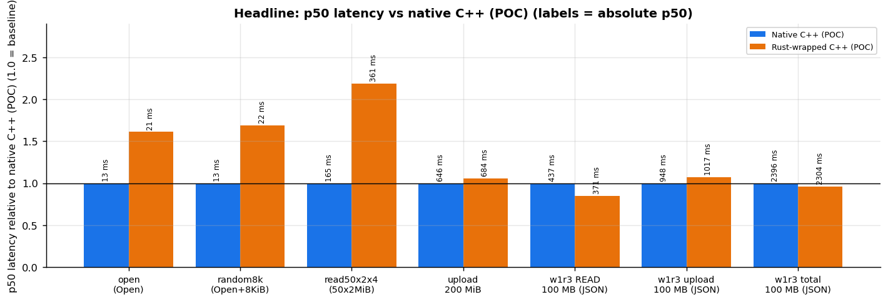

# GCS SDK Consolidation: C++ POC (Rust core + thin C++ wrapper)

> **Proof of concept, not for upstream.** This directory explores one question:
> can C++ users get Cloud Storage through the Rust `google-cloud-storage` crate,
> exposed via a C ABI with a thin C++ layer on top? It compares that path against
> native `google-cloud-cpp`.

It covers the three APIs the consolidation worklog asks for: **BidiRead,
BidiWrite (appendable objects) and ListObjects**. It also includes the JSON
paths used by the storage-shared-benchmarking `w1r3` workload. A benchmark
harness runs the same workloads against native `google-cloud-cpp`, and against
pure Rust (no wrapper).

```
 your C++ app
     │   gcs_rust::Client / ObjectDescriptor / AppendableWriter   (cpp/include/gcs_rust/client.h)
     ▼
 thin C++ wrapper   ── RAII, Status/StatusOr, std::function, exception firewall (cpp/src/client.cc)
     │   plain C calls: gcs_object_open(), gcs_appendable_append(), gcs_list_objects() …
     ▼
 gcs_core.h         ── generated by cbindgen from rust/src/lib.rs
 libgcs_core.a      ── built by cargo: Rust FFI layer + tokio runtime + google-cloud-storage
     │   gRPC BidiReadObject / BidiWriteObject / ListObjects, JSON read/write
     ▼
 Cloud Storage (Rapid / zonal bucket, and a standard bucket for JSON)
```

## Layout

| Path | What it is |
| --- | --- |
| `rust/src/lib.rs` | The Rust core's C ABI: opaque handles, status codes, panic/exception firewall |
| `rust/Cargo.toml` | Depends on `../../../src/storage` and `../../../src/gax` (this repo) |
| `rust/cbindgen.toml` | Settings for generating `gcs_core.h` |
| `rust/.cargo/config.toml` | Enables `--cfg google_cloud_unstable_storage_bidi` (required for appendable objects) |
| `rust/examples/pure_rust_bench.rs` | The same workloads (gRPC + w1r3 JSON) in pure Rust, to isolate wrapper overhead |
| `cpp/include/gcs_rust/client.h`, `cpp/src/client.cc` | The thin C++ SDK veneer |
| `cpp/examples/quickstart.cc` | End-to-end check: write → read back + verify → concurrent ranges → list → errors → delete |
| `cpp/bench/ssb_workloads.h` | SSB-equivalent workloads: `open`, `random8k`, `read50x2x4`, `w1r3` |
| `cpp/bench/ssb_rust_wrapped.cc`, `cpp/bench/ssb_native_cpp.cc` | SSB benchmark binaries (C++ → Rust core vs native google-cloud-cpp) |
| `cpp/bench/alloc_counter.{h,cc}` | `malloc`/`operator new` interposition to count heap bytes per op |
| `cpp/bench/*_bench.cc`, `bench_common.h` | Earlier simple benchmark (write / full read / random ranges / list) |
| `CMakeLists.txt` | cargo + cbindgen + C++ in one CMake build (no vcpkg needed) |
| `native/CMakeLists.txt` | Native google-cloud-cpp baseline (`add_subdirectory` of a google-cloud-cpp checkout) |
| `scripts/` | VM setup/build/run scripts, `analyze_ssb.py` (tables), `plot_ssb.py` (graphs) |
| `results/` | Raw CSVs, logs and graphs from the POC runs (see below) |

## Build

Prerequisites: Rust toolchain (the repo's `rust-toolchain.toml`), `cbindgen`,
`cmake`, `ninja`, `g++`.

```bash
cd examples/cpp-wrapper-poc
cmake -S . -B build -GNinja -DCMAKE_BUILD_TYPE=Release
cmake --build build        # quickstart, rust_wrapped_bench, ssb_rust_wrapped
(cd rust && cargo build --release --example pure_rust_bench)
```

**Offline build.** All Rust dependencies are pinned with checksums in
`rust/Cargo.lock`. To build with no network, run `cargo vendor` once and point
cargo at `vendor/`. This has been verified: 265 crates, built in a sandbox
with no network.

The native baseline is a separate CMake project. It needs a google-cloud-cpp
checkout, by default `../../../../google-cloud-cpp` (next to this repo); set
`-DGCS_POC_GOOGLE_CLOUD_CPP_DIR=...` to override. Its dependencies come from vcpkg:

```bash
cmake -S native -B native/build -GNinja -DCMAKE_BUILD_TYPE=Release \
  -DCMAKE_TOOLCHAIN_FILE=$HOME/vcpkg/scripts/buildsystems/vcpkg.cmake
cmake --build native/build --target ssb_native_cpp native_cpp_bench
```

> A full `install` of google-cloud-cpp currently fails: its
> `google/cloud/opentelemetry` exporter doesn't compile against the
> opentelemetry-cpp 1.28 in vcpkg. The benchmark doesn't need that exporter.

## Run

Uses Application Default Credentials.

```bash
./build/quickstart YOUR_RAPID_BUCKET [object-size-mib]

# SSB-equivalent workloads (same flags for both binaries)
./build/ssb_rust_wrapped    --bucket=YOUR_RAPID_BUCKET --w1r3-bucket=YOUR_STANDARD_BUCKET \
    --workload=open|random8k|read50x2x4|w1r3 --iterations=200 --out=out.csv
./native/build/ssb_native_cpp --bucket=YOUR_RAPID_BUCKET --w1r3-bucket=YOUR_STANDARD_BUCKET \
    --workload=open --iterations=200 --out=out.csv

# Pure Rust (no wrapper), gRPC workloads only
./rust/target/release/examples/pure_rust_bench --bucket=YOUR_RAPID_BUCKET --workload=open --iterations=200

# Tables and graphs
python3 scripts/analyze_ssb.py results/run-v3
python3 scripts/plot_ssb.py results/run-v3 <empty-dir> results/graphs
```

To reproduce on a fresh GCE VM, use `scripts/vm_setup.sh`, then `vm_build.sh`,
then `vm_run_ssb.sh <rapid-bucket> <standard-bucket> [iterations]`.

> Run benchmarks on a GCE VM in the **same zone as the bucket**. From a
> workstation, traffic goes over the WAN, so the numbers mostly measure the
> network, not the client.

## Results (POC runs)

> **Latest: [w1r3 JSON report](REPORT-w1r3.md)** — native C++ vs Rust-wrapped vs pure Rust, 200 iterations per size, CPU, RSS vs allocated memory, build time from scratch, binary and repo sizes, debugging experience.

Environment: c2-standard-60 in us-west4-a, a RAPID (zonal) bucket in the same
zone, and a STANDARD bucket for `w1r3`. Versions: google-cloud-rust `fe42ce042`
and google-cloud-cpp `v3.11.0`. Each workload ran for 200 iterations, with the
implementations run one after another (never at the same time). Across runs
v2–v4 there were 22,600 measurements and 0 errors.



| Workload (p50) | Native C++ | Rust-wrapped | Pure Rust | Notes |
| --- | --: | --: | --: | --- |
| `open` (Open object, gRPC) | 12.9–14.6 ms | 19.6–22.6 ms | 19.5 ms | 1.5–1.7× slower |
| `random8k` (Open + 8 KiB read) | 12.4–13.3 ms | 17.7–18.0 ms | 17.8 ms | 1.3–1.5× slower |
| `read50x2x4` (50 × 2 MiB concurrent) | 156.6–165 ms | 361–387 ms | 404 ms | 2.2–2.5× slower |
| Appendable upload 100 MB | 357 ms (p99 1123) | 352 ms (p99 525) | 313 ms | native has a ~1 s tail |
| Appendable upload 200 MiB | 608 ms (p99 2028) | 670 ms (p99 940) | 581 ms | wrapper adds a copy |
| `w1r3` READ 100 MB (JSON) | 437 ms | 372 ms | – | wrapped ~8–15% faster |
| `w1r3` DELETE | 41 ms | 48 ms | – | Rust deletes via gRPC control API |

What this shows:

* **The C ABI wrapper itself costs ~0 on reads.** Pure Rust and Rust-wrapped
  are within noise of each other (run v4, same VM). The read gap comes from
  the Rust SDK's bidi gRPC read path versus google-cloud-cpp's.
* **Uploads:** pure Rust is as fast as native C++ or faster, with much smaller
  tails. The wrapper adds ~40–90 ms because of one copy plus a single large
  append. That can be fixed with zero-copy slices and chunked appends.
* **Memory/CPU** (malloc interposition, run v3):
  * Uploads allocate 4.8 vs 2.5 bytes per byte. 1.0 B/B of that is the
    wrapper's `Bytes::copy_from_slice`, which is fixable.
  * JSON reads allocate ~4 B/B inside the Rust HTTP stack (native 0.03 B/B).
  * On `w1r3`, process CPU is +51%.
  * On gRPC workloads, total CPU is about equal, and peak RSS is 7–19% lower.

All graphs are in [`results/graphs/`](results/graphs). Raw CSVs and logs are in
`results/run-v2`, `run-v3` (with CPU and allocation columns) and `run-v4`
(adds pure Rust, 2 passes).

## How the C ABI works (C++-relevant decisions)

* **Blocking calls, async inside.** Each `GcsClient` owns a multi-threaded Tokio
  runtime. Every C function `block_on`s a Rust future, so C++ sees ordinary
  blocking calls. It is safe to call from many C++ threads at once. (Native C++
  has `future<T>` async; this POC does not expose an async API.)
* **Zero-copy reads.** `gcs_object_read_range` passes each received chunk to a
  callback as `(const uint8_t*, size_t)`. The pointer is only valid during the
  callback. The callback runs on the *calling* C++ thread.
* **One copy on writes.** `gcs_appendable_append` copies caller bytes into
  `bytes::Bytes`. That is needed because Rust may keep the buffer after the call
  returns, for retries and the replay buffer.
* **Error model.** Every function returns a canonical gRPC code and fills
  `GcsStatus{code, message}`. The C++ layer maps it 1:1 to
  `gcs_rust::Status`, using the same numbering as `google::cloud::StatusCode`.
  Richer details (`ErrorInfo`, request IDs, HTTP headers) exist on the Rust
  error, but this POC doesn't bridge them.
* **Unwinding firewall.** Rust panics are caught (`catch_unwind`) and returned
  as `INTERNAL`. C++ exceptions thrown inside callbacks are caught in the
  trampoline, Rust is told to stop, and the exception is rethrown after the C
  call returns. Nothing ever unwinds across the FFI boundary.
* **Lifetimes.** Descriptors and writers hold an `Arc` of the runtime, so they
  may outlive the `Client`. All handles are freed by RAII deleters.
* **Concurrency.** One `ObjectDescriptor` serves many concurrent range reads
  over a single BidiReadObject stream. `AppendableWriter` is single-threaded.

## Known gaps / caveats

* No async (`future<T>`) API; concurrency comes from C++ threads.
* C++ credential objects can't be passed to Rust, so the Rust core uses its own
  ADC/credentials (a separate token cache).
* No DirectPath in the Rust crate. Delete goes over gRPC `StorageControl`.
  BidiWrite needs `--cfg google_cloud_unstable_storage_bidi`.
* C++ OpenTelemetry tracing and logging don't see what happens inside Rust.
* Benchmarks are from a single VM and zone. Absolute numbers vary between runs.
  Compare ratios, not single values.
