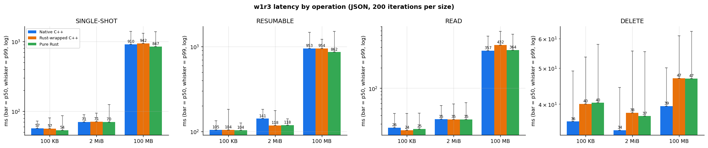
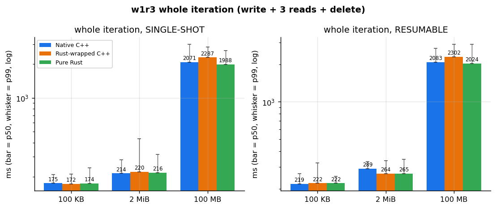
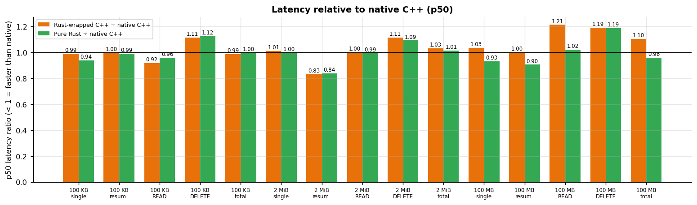
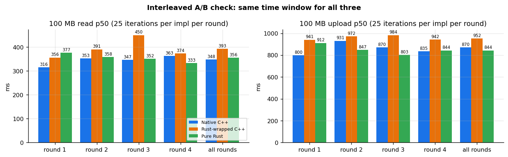
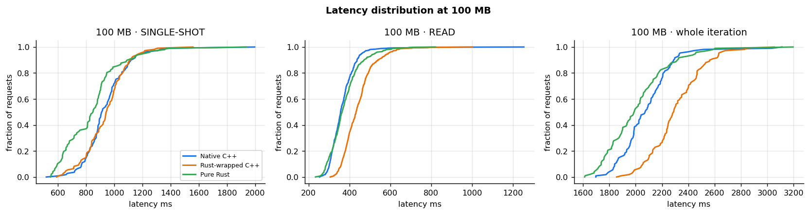
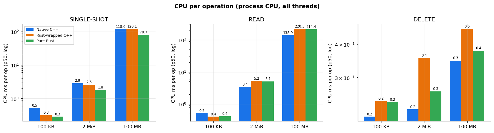
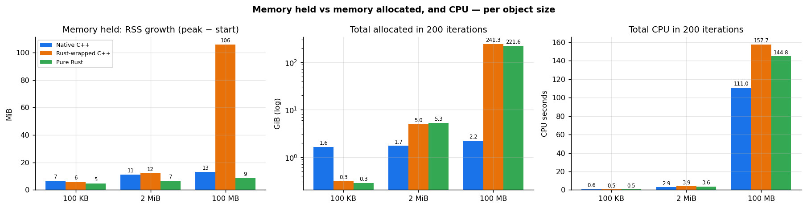
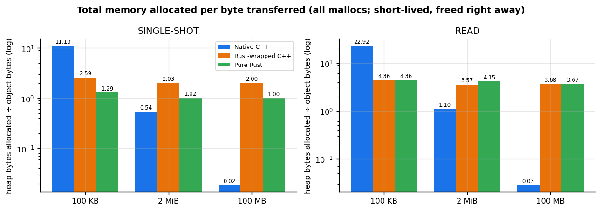
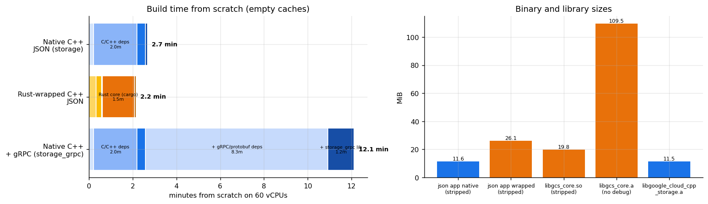

# C++ on a Rust core: w1r3 (JSON) results, build cost, challenges

GCE c2-standard-60, us-west4-a, STANDARD bucket in the same region. google-cloud-cpp v3.11.0 vs google-cloud-rust `fe42ce042`. Run on 2026-10-13.

| Name | What it is |
| --- | --- |
| **Native C++** | google-cloud-cpp `storage::Client` (today) |
| **Rust-wrapped C++** | C++ → C ABI → Rust SDK (this POC) |
| **Pure Rust** | Rust SDK called directly (= a perfect wrapper) |

`w1r3` iteration = 1 upload + 3 full reads + 1 delete. **200 iterations per size** (100 KB, 2 MiB, 100 MB) per implementation, plus an **interleaved 100 MB A/B** (4 rounds × 25 iterations). **12,600 measurements, 0 errors.** CPU = process CPU, all threads. Memory = **RSS** (held) and **total allocated** (every `malloc`). Raw data: [`results/run-v5-w1r3/`](results/run-v5-w1r3).

## 1. Summary

1. **Speed is the same.** At 100 KB and 2 MiB, all three are within ±5%. At 100 MB, pure Rust = native on reads and 7–10% faster on uploads. **The POC wrapper adds 9–20% at 100 MB.** It comes from an upload copy and a read slowdown not yet found. This is fixable POC work.
2. **CPU is mixed.** Rust is lower for small objects and uploads (about half at 100 KB, −33% for a 100 MB upload). Rust is **50–55% higher on reads ≥ 2 MiB**. This is inside the Rust SDK, because pure Rust shows the same.
3. **Memory held is the same or lower.** Pure Rust RSS grows 5–9 MiB vs 7–13 MiB for C++. The one spike (+106 MiB at 100 MB) is the wrapper's upload copy (fixable).
4. **Memory allocated is much higher, by design.** Rust allocates ~3.7 B per byte read (hyper owns the read buffers) and 1 B per byte uploaded (copy kept for retries). C++ reuses one buffer. The extra memory is freed right away, but it costs CPU.
5. **Build.** From scratch takes about the same time (2.2 vs 2.7 min, JSON only). A one-file rebuild is **4× slower** (39 s vs 10 s), the app is **2.3× bigger** (27 vs 12 MB stripped), and every builder needs a **620 MB Rust toolchain + 276 crates**.
6. **SSB CPU and memory can't be compared between C++ and Rust.** C++ measures the whole process (all threads). Rust measures only its own tokio task (CPU) and only the calling thread (memory). Latency can be compared.

## 2. Latency



| p50 ms | Native C++ | Rust-wrapped | Pure Rust | Pure vs native |
| --- | --: | --: | --: | --: |
| 100 KB upload (single-shot) | 57 | 57 | 54 | same |
| 100 KB read | 24–32 | 21–31 | 22–31 | same |
| 2 MiB upload (resumable) | 142 | 118 | 118 | **17% faster** |
| 2 MiB read | 32–43 | 31–42 | 32–43 | same |
| 100 MB upload (single-shot) | 910 | 942 | 847 | **7% faster** |
| 100 MB read | 343–384 | 416–454 | 345–378 | same |
| Delete | 34–40 | 38–47 | 37–47 | +4–8 ms (Rust deletes via gRPC) |
| Whole iteration, 100 MB | 2,071 | 2,287 | 1,988 | 4% faster |





**Interleaved A/B, 100 MB:**
- Read p50: native 348 ms, **wrapped 393 ms (+13%)**, pure Rust 356 ms.
- Upload p50: native 870 ms, **wrapped 952 ms (+9%)**, pure Rust 844 ms.

The wrapper uses the same read CPU as pure Rust, so the extra time is not extra work. The likely cause is a thread hand-off in the blocking bridge.





## 3. CPU



| CPU ms per op (p50) | Native C++ | Rust-wrapped | Pure Rust |
| --- | --: | --: | --: |
| 100 KB upload | 0.52 | 0.32 | 0.29 |
| 100 KB read | 0.52 | 0.40 | 0.42 |
| 2 MiB read | 3.4 | 5.2 | 5.1 |
| 100 MB upload | 119 | 120 | **80** |
| 100 MB read | 139 | 220 | **214** |
| **200 iterations at 100 MB (s)** | **111** | **158** | **145** |

## 4. Memory: held vs allocated



| 200 iterations | Native C++ | Rust-wrapped | Pure Rust |
| --- | --: | --: | --: |
| **RSS growth**, 100 KB / 2 MiB / 100 MB | 7 / 11 / 13 MiB | 6 / 12 / **106** MiB | 5 / 7 / 9 MiB |
| **Total allocated**, 100 KB | 1.6 GiB | 0.3 GiB | 0.3 GiB |
| **Total allocated**, 2 MiB | 1.7 GiB | 5.0 GiB | 5.3 GiB |
| **Total allocated**, 100 MB | 2.2 GiB | 241 GiB | 222 GiB |



- **C++:** a fixed ~2–2.5 MB per op (the 2 MiB read buffer, among others). That is more than Rust at 100 KB (23 B/B) and almost nothing per byte at 100 MB (0.03 B/B).
- **Rust:** grows with the data. Reads are ~3.7 B/B (a new buffer per network chunk) and uploads 1.0 B/B (retry copy). These are **by design in the Rust SDK**, not the POC, and would only change with a "read into my buffer" API.
- **Wrapper:** adds one upload copy (2.0 B/B, and the +106 MiB RSS spike). Fixable with zero-copy.

## 5. Repo size, build time, binary size

All builds started from scratch with empty caches, on the same 60-vCPU VM.



| Build step | Native C++ (JSON) | Rust-wrapped C++ (JSON) |
| --- | --: | --: |
| Tools | vcpkg: 13 s | Rust toolchain: 19 s + cbindgen: 15 s |
| Dependencies | abseil, crc32c, curl, openssl, nlohmann-json, opentelemetry-cpp: **118 s** | 276 crates: 2 s download (compiled inside the core) |
| Library | storage: **24 s** | Rust core: **88 s** |
| App | 5 s | wrapper + app: 4.5 s |
| **Total** | **2.7 min** | **2.2 min** |
| Library build on 8 cores | 67 s | 107 s |
| **One-file rebuild** | **10 s** | **39 s** |
| Reference: native + gRPC (storage_grpc) | 12.1 min (gRPC/protobuf deps alone: 8.3 min) | – |

The Rust-wrapped build needs no vcpkg. An app that also uses other google-cloud-cpp libraries still needs vcpkg **and** Rust.

| Disk and size | Native C++ | Rust-wrapped |
| --- | --: | --: |
| Toolchain | system C++ compiler | Rust: 210 MB download, **620 MB** installed |
| Dependency sources | 123 MB installed | **352 MB** crates (vendored: 293 MB, or 43 MB tgz) |
| Build folder | 43 MB | **1.5 GB** |
| Minimal JSON app, **stripped** / unstripped | **12.1 MB** / 14.7 MB | **27.3 MB** / 158 MB |
| Storage libraries | storage 12.1 + rest_internal 7.0 + common 2.6 MB (41 MB with deps) | `libgcs_core.a` 389 MB (115 MB without debug info); `.so` 20.7 MB stripped |

| Repository | google-cloud-cpp | google-cloud-rust |
| --- | --: | --: |
| Full git clone | **13.8 GB** (11,713 commits) | 0.83 GB (4,764 commits) |
| Shallow clone / tarball | 675 MB / 18.9 MB | 467 MB / 28.9 MB |
| Files / libraries | 23,220 / 170 | 5,072 / 346 crates |
| Storage code (lines, incl. tests) | 171,565 | 134,195 |
| Storage download for users | whole repo or tarball | `google-cloud-storage` crate: 0.5 MB + 275 other crates |
| POC glue | C++ wrapper: 627 lines | C ABI: 1,005 lines |

## 6. Key Challenges: C++ column

Assumes Rust feature parity, with fixable POC items fixed.

| Challenge | C++ |
| --- | --- |
| **Mono Repo** | **Needs alignment / High effort:** google-cloud-cpp (13.8 GB, 170 libraries, one release for all) would depend on a google-cloud-rust crate (346 crates, released one at a time). Each feature is Rust → C ABI → C++ across 2 repos. Each C++ release pins a crate version and a 276-crate lock file. |
| **Platform-specific issues** | **Medium risk:** Each target needs its own Rust build and link setup (Windows CRT, musl, macOS). Apps get a second TLS/HTTP stack (rustls + aws-lc + hyper/tonic) and tokio threads (one per CPU). Fixable. |
| **Platform reach** | **High risk:** Every builder needs Rust ≥ 1.91 (620 MB) + cargo + 276 crates. Debian 12 ships rustc 1.63, so distro packages break. The alternative is signed prebuilt libraries per platform, a pipeline that doesn't exist today. |
| **Package Size** | **Medium:** Minimal JSON app is 27.3 vs 12.1 MB stripped (+15 MB). Rust static library is 115 MB (389 MB with debug info). Two network stacks in gRPC apps. |
| **Tool chain, coordination and maintenance costs** | **High effort:** From scratch is similar (2.2 vs 2.7 min), but a **one-file rebuild takes 39 s vs 10 s**, the build folder is 1.5 GB, and 276 crates need CVE and license review. Every API is written 3 times. C++ policies and mocks don't cross the C ABI. Fix flow: Rust release → C++ bump → C++ release. |
| **Impedance mismatches** | **Manageable (JSON); gRPC reads open:** JSON latency equal (pure Rust 0.90–1.06×). CPU −33–55% on small requests and uploads, **+50–55% on reads ≥ 2 MiB**. RSS same or lower. Allocations by design: ~3.7 B/B reads, 1 B/B uploads. gRPC bidi reads 1.5–2.5× slower in earlier runs (Rust SDK; wrapper ≈0). C++-only objects (`Credentials`, policies, gRPC channel options) must be re-plumbed. |
| **Harder debugging experience** | **High effort, not a blocker:** see §7. |

## 7. Harder debugging experience: Today vs Future

**Today:**
- C++ users debug with gdb/lldb/Visual Studio, ASan/TSan/MSan, valgrind, heaptrack and perf.
- Every frame is C++, running on the caller's thread or `BackgroundThreads`.
- One switch (`GOOGLE_CLOUD_CPP_ENABLE_TRACING`) and one OpenTelemetry pipeline cover logging and tracing.
- Sanitizers run in CI.

**Future with a Rust core:**
- **Stacks are mixed.** You see C++ + C ABI + async Rust, and the work runs on **tokio threads**, so the caller's stack only shows "waiting". In the POC, gdb showed `ObjectDescriptor::Read` → `gcs_object_read_range` → `block_on`, while the data was handled by `bidi::worker::Worker::run` on another thread.
- **Breakpoints:** Rust generic symbols are hundreds of characters long, and **break-by-name failed** in the POC (we had to break by address). Readable frames need debug info, which makes the library 389 MB instead of 115 MB.
- **Logs split in two:** `GOOGLE_CLOUD_CPP_ENABLE_TRACING` and `GRPC_TRACE` don't reach Rust. `RUST_LOG` needs a logger the C ABI doesn't install, so by default there are no transport logs.
- **Panics** must be caught at the C boundary or the process aborts. Once caught, they become a plain `INTERNAL` error, and the backtrace is lost unless `RUST_BACKTRACE=1` is set.
- **Sanitizers** across the boundary need nightly Rust.
- **Profiling:** the 50–55% read-CPU gap sits inside hyper and tokio. Tools that hook `operator new` (like SSB) miss Rust allocations, so we had to hook `malloc`.
- **Triage crosses repos and languages.**

| Consideration | Today | Future |
| --- | --- | --- |
| Stack traces | C++ only, caller's thread | C++ + C ABI + async Rust on tokio threads |
| Breakpoints | by name | often by address |
| Logs | `GOOGLE_CLOUD_CPP_ENABLE_TRACING` | + `RUST_LOG`, needs a bridge |
| Sanitizers | stable, in CI | nightly Rust |
| Memory profiling | `operator new` hooks | must hook `malloc` |
| Who fixes it | C++ maintainers | C++ **and** Rust, across 2 repos |

**Mitigations:**
- A Rust logger in the C ABI, controlled by `GOOGLE_CLOUD_CPP_ENABLE_TRACING`, that feeds C++ logging and OpenTelemetry.
- Panic backtraces returned in the error.
- Split debug symbols.
- A gdb/lldb guide.
- One CPU/memory method in SSB for every language.

## 8. Set up and run

```bash
# 1. Rust toolchain (official signed tarball; distro Rust is too old)
V=1.99.0; T=rust-$V-x86_64-unknown-linux-gnu
curl -sSfLO https://static.rust-lang.org/dist/$T.tar.xz
curl -sSfLO https://static.rust-lang.org/dist/$T.tar.xz.sha256 && sha256sum -c $T.tar.xz.sha256
tar xf $T.tar.xz && ./$T/install.sh --prefix=$HOME/.local/rust --components=rustc,cargo,rust-std-x86_64-unknown-linux-gnu
export PATH=$HOME/.local/rust/bin:$HOME/.cargo/bin:$PATH
cargo install cbindgen --locked --version 0.29.2

# 2. Code
git clone -b poc/cpp-rust-wrapper https://github.com/v-pratap/google-cloud-rust.git
git clone --depth 1 -b v3.11.0 https://github.com/googleapis/google-cloud-cpp.git   # native baseline only
cd google-cloud-rust/examples/cpp-wrapper-poc

# 3. Rust-wrapped C++ (no vcpkg)
cmake -S . -B build -GNinja -DCMAKE_BUILD_TYPE=Release && cmake --build build
./build/quickstart YOUR_RAPID_BUCKET 8          # prints PASS
(cd rust && cargo build --release --example pure_rust_bench --target-dir ../build/cargo)

# 4. Native baseline
git clone https://github.com/microsoft/vcpkg.git ~/vcpkg && ~/vcpkg/bootstrap-vcpkg.sh -disableMetrics
cmake -S native -B native/build -GNinja -DCMAKE_BUILD_TYPE=Release \
  -DCMAKE_TOOLCHAIN_FILE=$HOME/vcpkg/scripts/buildsystems/vcpkg.cmake \
  -DGCS_POC_GOOGLE_CLOUD_CPP_DIR=$PWD/../../../google-cloud-cpp
cmake --build native/build --target ssb_native_cpp

# 5. w1r3, 200 iterations per size, then tables + graphs
B=YOUR_STANDARD_BUCKET
for s in 100000 2097152 100000000; do
  ./native/build/ssb_native_cpp --bucket=$B --workload=w1r3 --iterations=200 --object-sizes=$s --out=native_cpp-w1r3-$s.csv
  ./build/ssb_rust_wrapped      --bucket=$B --workload=w1r3 --iterations=200 --object-sizes=$s --out=rust_wrapped-w1r3-$s.csv
  ./build/cargo/release/examples/pure_rust_bench --bucket=$B --workload=w1r3 --iterations=200 --object-sizes=$s --out=rust_pure-w1r3-$s.csv
done
python3 scripts/analyze_w1r3.py . graphs
```

JSON-only google-cloud-cpp build: `-DGOOGLE_CLOUD_CPP_ENABLE="storage;-monitoring;-trace;-opentelemetry;-universe_domain"` (it still needs the opentelemetry-cpp headers).

VM scripts, to run in the same region as the bucket:
- `scripts/vm_run_w1r3.sh`: benchmarks
- `scripts/vm_run_ab100mb.sh`: A/B check
- `scripts/vm_measure_build.sh` + `scripts/vm_measure_native.sh`: builds and sizes
